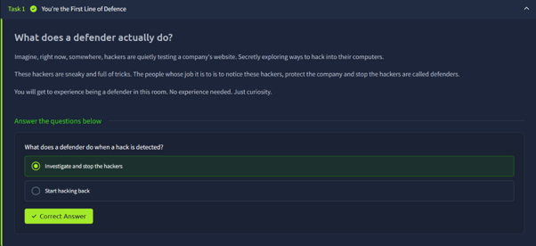
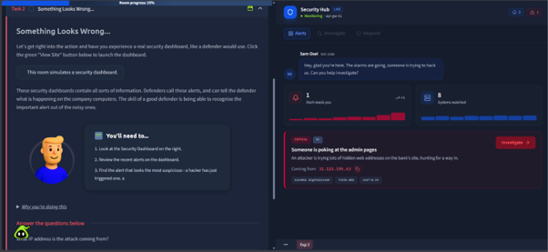
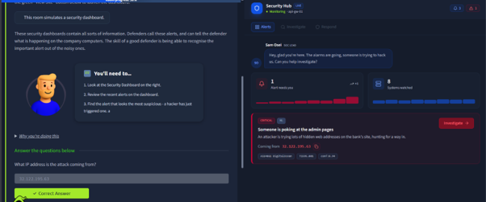
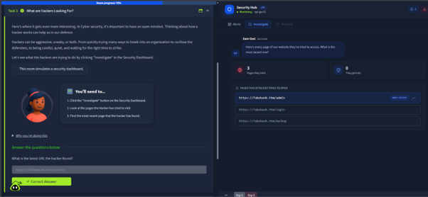
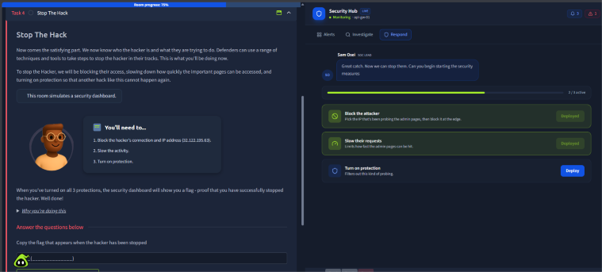
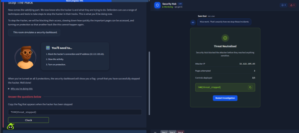

# Defensive Security Intro

**Room Link:** [TryHackMe – Defensive Security Intro](https://tryhackme.com/room/defensivesecurity)
**Module:** Module 1 – Introduction to Cyber Security
**Difficulty:** Easy
**Status:** ✅ Completed

## Objective
- Experience the role of a defender using a simulated security dashboard.
- Spot a suspicious alert, investigate it, and stop the attacker.

## Key Concepts
- **Defensive security** – noticing attackers, protecting the organisation and stopping the attack.
- **Security dashboard / alerts** – a screen that shows what is happening on company systems.
- **Alert triage** – picking the important alert out of the noisy ones.
- **Containment controls** – block the source, rate-limit requests, turn on filtering.

---

## Task 1 – You're the First Line of Defence

**Summary:** Hackers are constantly testing company websites for ways in. The people whose job is to notice them, protect the company and stop them are called **defenders**. No prior experience is needed for this room.

| # | Question | Answer |
|---|----------|--------|
| 1 | What does a defender do when a hack is detected? | `Investigate and stop the hackers` |

**Notes:** A defender responds to an attack by investigating and stopping it. "Hacking back" is not part of the job.

**Screenshot:**

---

## Task 2 – Something Looks Wrong ...

**Summary:** The room simulates a **Security Hub** dashboard used by a SOC (Security Operations Center). The skill of a good defender is recognising the *important* alert among the noisy ones. One critical alert needs attention: *"Someone is poking at the admin pages"* – an attacker is trying lots of hidden web addresses on the bank's site.

**Alert details:**
- Severity: **Critical**
- Source IP: `32.122.195.63`
- Network owner shown on the alert: AS14061 DigitalOcean
- Technique tag on the alert: T1595.001, confidence 0.94

| # | Question | Answer |
|---|----------|--------|
| 1 | What IP address is the attack coming from? | `32.122.195.63` |

**Notes:** This matches the attacker's side of the story in the Offensive Security Intro room: the attacker guesses hidden page names (like `dirb` did), and the defender sees that activity as an alert.

**Screenshots:**

---

## Task 3 – What are Hackers Looking For?

**Summary:** Clicking **Investigate** on the alert shows every page the attacker tried to open. Thinking about how a hacker works helps the defender. Hackers can be aggressive (many attempts quickly) or quiet and patient.

**Pages the attacker tried:**

| URL | Note |
|-----|------|
| `https://fakebank.thm/admin` | Most recent |
| `https://fakebank.thm/login` | |
| `https://fakebank.thm/backup` | |

Summary on the dashboard: 3 pages tried, 0 got in.

| # | Question | Answer |
|---|----------|--------|
| 1 | What is the latest URL the hacker found? | `https://fakebank.thm/admin` |

**Notes:** The attacker went after pages that look valuable (admin, login, backup). Reviewing which pages are targeted shows what the attacker wants.

**Screenshot:**

---

## Task 4 – Stop The Hack

**Summary:** Once the attacker and their behaviour are known, the defender takes action. Under the **Respond** tab, three protections must be deployed:

1. **Block the attacker** – block IP `32.122.195.63` at the edge.
2. **Slow their requests** – limit how fast the admin pages can be hit (rate limiting).
3. **Turn on protection** – filter out this kind of probing.

After all 3/3 controls are deployed, the dashboard shows "Threat Neutralised" and a flag.

| # | Question | Answer |
|---|----------|--------|
| 1 | Copy the flag that appears when the hacker has been stopped | `THM{threat_stopped}` |

**Notes:** Each control does a different job. Blocking removes the known attacker, rate limiting makes automated guessing impractical, and filtering protects against the same behaviour from other sources in the future.

**Screenshots:**

Responding to the alert (2 of 3 controls active):

Threat neutralised and flag:

---

## Takeaways
- Defenders watch dashboards, pick out the important alert, investigate it, then respond.
- Investigation answers *who* (source IP) and *what* (pages attempted).
- Response combines several layers: block, slow down and filter.
- Offensive and defensive security are two views of the same event, and each side helps the other improve.
