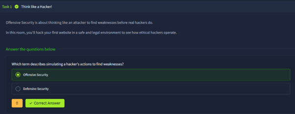
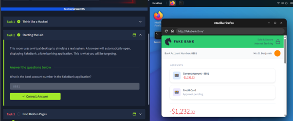
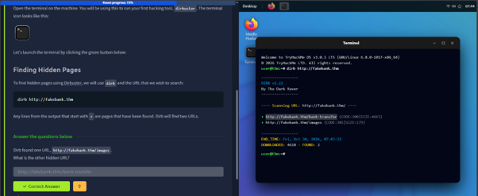

# Task 1 - Offensive Security Introduction

## Room / Topic
- Offensive Security Introduction

## Objective
- Identify what offensive security is.
- Understand how attackers think when targeting systems in order to find weaknesses.

## Key Concepts
- Ethical hacking
- Reconnaissance
- Vulnerability assessment
- Exploitation
- Penetration testing

## Tasks & Answers

### Task 1
**Question:** What is offensive security?

**Answer:** Offensive security is an approach that evaluates system security by simulating attacks to identify weaknesses before unauthorized parties can find and exploit them.

**Screenshot:**

---

### Task 2
**Question:** Why is offensive security useful?

**Answer:** It helps organizations identify system weaknesses, understand potential risks, and improve security before a real attack occurs.

**Screenshot:**

---

### Task 3
**Question:** Is offensive security the same as illegal activity?

**Answer:** No. Proper offensive security is performed ethically and with authorization, such as penetration testing or red teaming, and differs from unauthorized hacking.

**Screenshot:**

## Notes
- Offensive security involves thinking like an attacker, but within a legitimate and authorized context.
- It is important for identifying real weaknesses before systems are used on a large scale.
- Ethical hacking helps strengthen systems and reduce actual risk.

## Reflection
- I learned that offensive security is not just "hacking," but a professional way to assess and improve security.
- I can see the close relationship between defensive and offensive security.
- In conclusion, organizations need both areas to evaluate the strength of their security comprehensively.

## Room Completion

