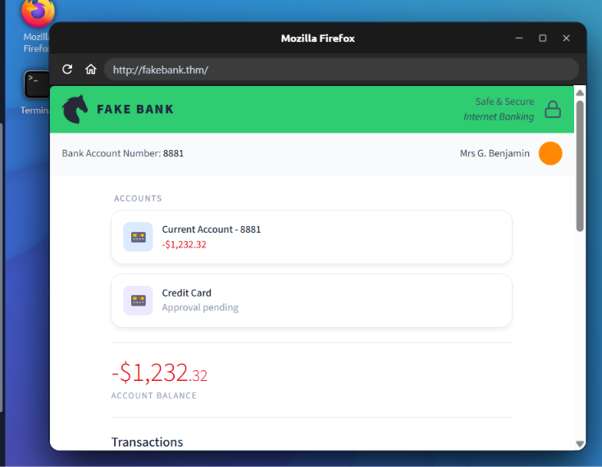
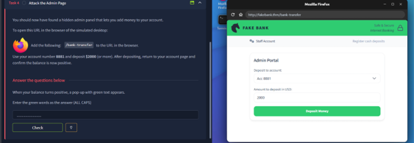
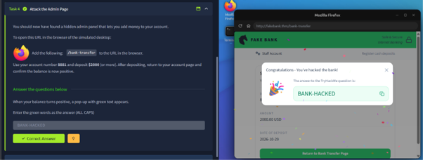

# Offensive Security Intro

**Room Link:** [TryHackMe – Offensive Security Intro](https://tryhackme.com/room/offensivesecurityintro) <br>
**Module:** Module 1 – Introduction to Cyber Security <br>
**Difficulty:** Easy<br>
**Status:** ✅ Completed

## Objective
- Understand what offensive security is: thinking and acting like an attacker to find weaknesses before real attackers do.
- Hack a fake banking website (FakeBank) in a safe and legal lab.

## Key Concepts
- **Offensive security** – simulating an attacker's actions to discover weaknesses.
- **Directory / hidden page discovery** – finding pages that are not linked anywhere on a website.
- **Dirbuster (`dirb`)** – a tool that guesses page and folder names from a wordlist.
- **Broken access control** – a sensitive page that anyone can open because nothing protects it.

---

## Task 1 – Think like a Hacker!

**Summary:** Offensive security means thinking like an attacker so weaknesses can be found and fixed before real hackers exploit them. This room lets me hack my first website in a safe and legal environment.

| # | Question | Answer |
|---|----------|--------|
| 1 | Which term describes simulating a hacker's actions to find weaknesses? | `Offensive Security` |

**Notes:** The other option, Defensive Security, is the opposite side: detecting and stopping attacks. Offensive security is about *attacking first (with permission)* to find the holes.

**Screenshot:**


---

## Task 2 – Starting the Lab

**Summary:** The room runs a virtual desktop. A browser opens automatically on **FakeBank** (`http://fakebank.thm/`), a fake banking application that is the target for the rest of the room.

| # | Question | Answer |
|---|----------|--------|
| 1 | What is the bank account number in the FakeBank application? | `8881` |

**Notes:** The account number is shown at the top of the page and on the "Current Account" card. The balance starts negative (-$1,232.32), which sets up the goal of Task 4.

**Screenshot:**


---

## Task 3 – Find Hidden Pages

**Summary:** Open the terminal on the lab machine and run Dirbuster against the website to look for pages that are not linked from the main site.

**Command used:**

```bash
dirb http://fakebank.thm
```

Lines starting with `+` in the output are pages that were found. Dirb found two URLs:

| URL | Response code |
|-----|---------------|
| `http://fakebank.thm/images` | 301 |
| `http://fakebank.thm/bank-transfer` | 200 |

| # | Question | Answer |
|---|----------|--------|
| 1 | Dirb found one URL, `http://fakebank.thm/images`. What is the other hidden URL? | `http://fakebank.thm/bank-transfer` |

**Notes:** Dirb tries thousands of common page names (about 4,600 in this run) and reports the ones that exist. The `bank-transfer` page returned code 200, meaning it can be opened directly even though no link leads to it.

**Screenshot:**


---

## Task 4 – Attack the Admin Page

**Summary:** The hidden page is an admin panel that lets anyone add money to an account.

**Steps:**
1. In the lab browser, go to `http://fakebank.thm/bank-transfer`.
2. In the **Admin Portal**, choose account `8881` and enter `2000` as the amount.
3. Click **Deposit Money**.
4. Return to the account page; the balance is now positive and a pop-up with green text appears.

| # | Question | Answer |
|---|----------|--------|
| 1 | Enter the green words from the pop-up (ALL CAPS) | `BANK-HACKED` |

**Notes:** The admin portal was only "protected" by being hidden. Once it was discovered with Dirbuster, no login or permission check stopped me from using it. Hiding a page is not the same as securing it.

**Screenshots:**

Account page before the deposit (negative balance):



Admin portal – deposit of 2000 USD to account 8881:



Success pop-up:



---

## Takeaways
- Offensive security = finding weaknesses the way an attacker would, but legally and with permission.
- Discovering hidden pages is an early and simple step, and tools like `dirb` automate it.
- "Security through obscurity" does not work: sensitive pages need real access control (authentication and authorisation).
- This room is the attacker's view of FakeBank; the **Defensive Security Intro** room shows the defender's view of the same attack.
