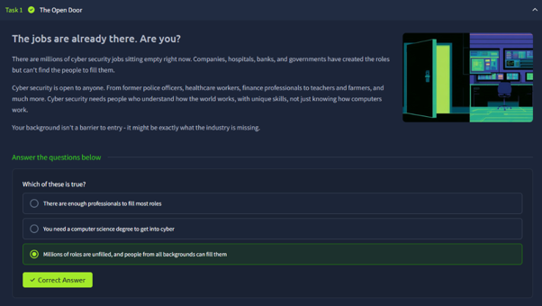
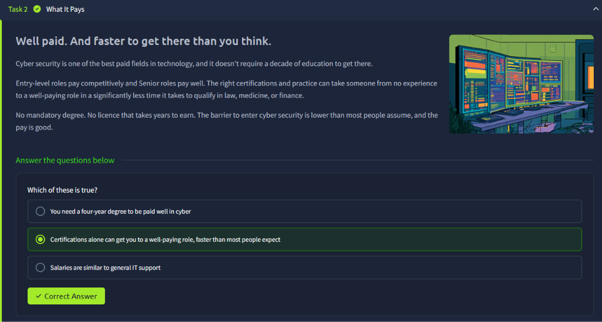
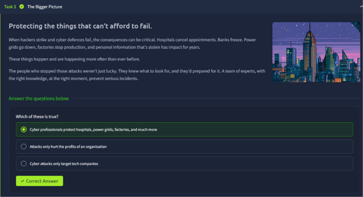
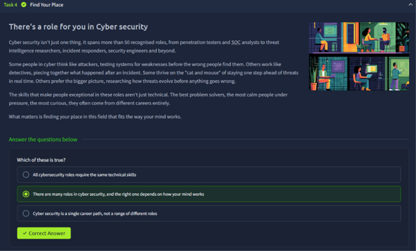
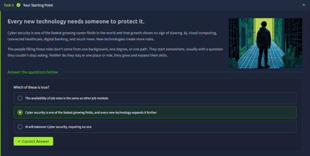
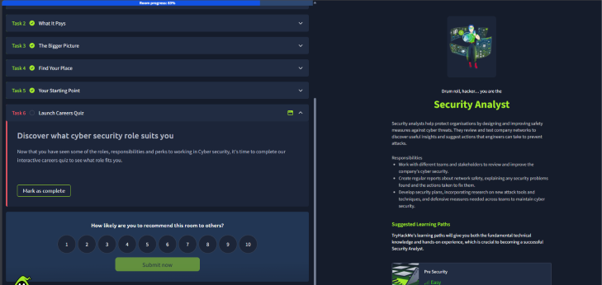

# Careers in Cyber

**Room Link:** [TryHackMe – Careers in Cyber](https://tryhackme.com/room/careersincyber)
**Module:** Module 1 – Introduction to Cyber Security
**Difficulty:** Easy
**Status:** ✅ Completed

## Objective
- Understand the job market, pay and range of roles in cyber security.
- Find out which role may suit me using the careers quiz.

## Key Concepts
- Skills shortage: many cyber roles are unfilled.
- Entry through certifications and practice, not only a degree.
- More than 50 recognised roles (penetration tester, SOC analyst, threat intelligence researcher, incident responder, security engineer and more).
- Career growth driven by new technology (AI, cloud, connected healthcare, digital banking).

---

## Task 1 – The Open Door

**Summary:** There are millions of cyber security jobs that are currently unfilled. People from many backgrounds can enter the field, and a different background can be a strength.

| # | Question | Answer |
|---|----------|--------|
| 1 | Which of these is true? | `Millions of roles are unfilled, and people from all backgrounds can fill them` |

**Notes:** A computer science degree is not required to start.

**Screenshot:**

---

## Task 2 – What It Pays

**Summary:** Cyber security is one of the best paid fields in technology, and it can be reached faster than fields like law, medicine or finance. The right certifications and practice can move someone from no experience to a well-paid role.

| # | Question | Answer |
|---|----------|--------|
| 1 | Which of these is true? | `Certifications alone can get you to a well-paying role, faster than most people expect` |

**Notes:** No mandatory degree and no licence that takes years to earn.

**Screenshot:**

---

## Task 3 – The Bigger Picture

**Summary:** Failed cyber defences have serious consequences: hospitals cancel appointments, banks freeze, power grids go down and factories stop. Prepared teams of experts prevent these incidents.

| # | Question | Answer |
|---|----------|--------|
| 1 | Which of these is true? | `Cyber professionals protect hospitals, power grids, factories, and much more` |

**Notes:** Attacks affect critical services and people, not just company profits or tech companies.

**Screenshot:**

---

## Task 4 – Find Your Place

**Summary:** Cyber security is a range of roles, not a single career path. Some people think like attackers, some work like detectives after an incident, some enjoy staying one step ahead of threats, and others research how threats evolve. The best fit depends on how your mind works.

| # | Question | Answer |
|---|----------|--------|
| 1 | Which of these is true? | `There are many roles in cyber security, and the right one depends on how your mind works` |

**Notes:** Soft skills such as problem solving, staying calm under pressure and curiosity matter as much as technical skills.

**Screenshot:**

---

## Task 5 – Your Starting Point

**Summary:** Every new technology needs someone to protect it, so cyber security keeps growing. People start from different backgrounds and keep expanding their skills and roles.

| # | Question | Answer |
|---|----------|--------|
| 1 | Which of these is true? | `Cyber security is one of the fastest growing fields, and every new technology expands it further` |

**Notes:** AI is not expected to replace the need for security people; new technology creates more roles.

**Screenshot:**

---

## Task 6 – Launch Careers Quiz

**Summary:** An interactive quiz that suggests a role based on your answers. There is no flag or question to answer; the task is completed by finishing the quiz.

**My result: Security Analyst**

Security analysts help protect organisations by designing and improving safety measures. Their responsibilities include:
- Working with different teams to review and improve the company's cyber security.
- Writing regular reports about network safety, the problems found and the actions taken.
- Developing security plans using research on new attack tools and defensive measures.

The suggested learning path for this role is **Pre Security**, which is the path I am on now.

**Screenshot:**

---

## Takeaways
- Cyber security has a large skills gap and many entry routes, so my background in cybersecurity studies fits well.
- There are many different roles; I should keep exploring to see which suits me (the quiz suggested Security Analyst).
- Certifications and hands-on practice (like these TryHackMe rooms) are a practical way to build skills.
