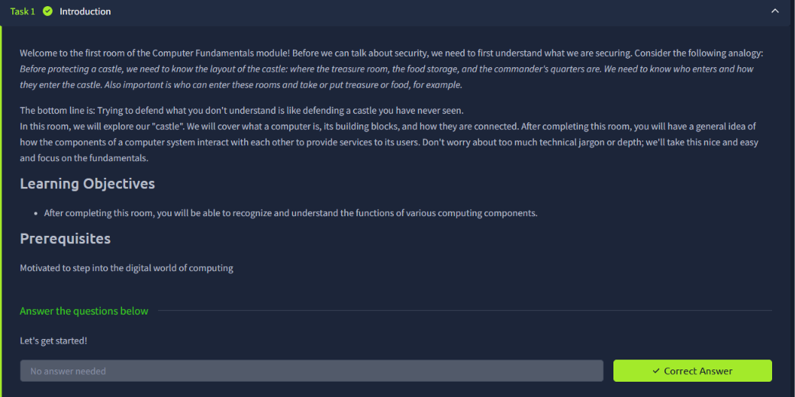
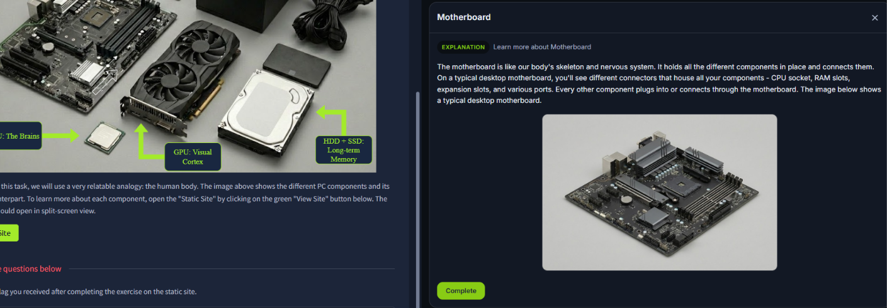
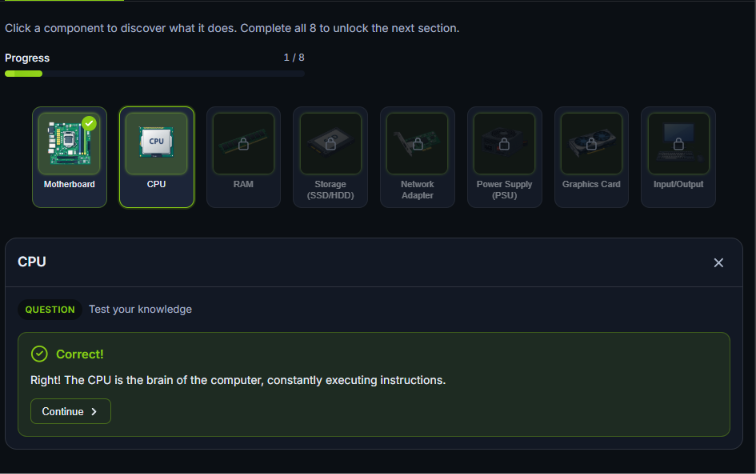
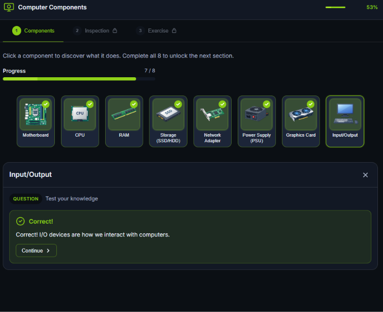
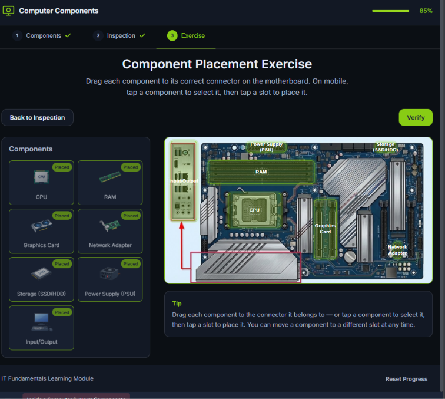
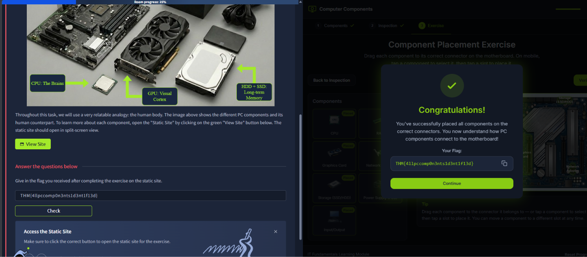
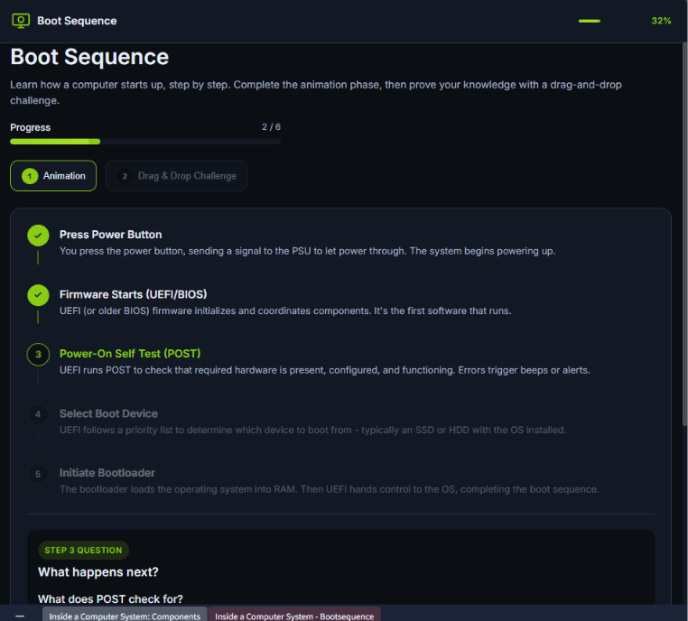
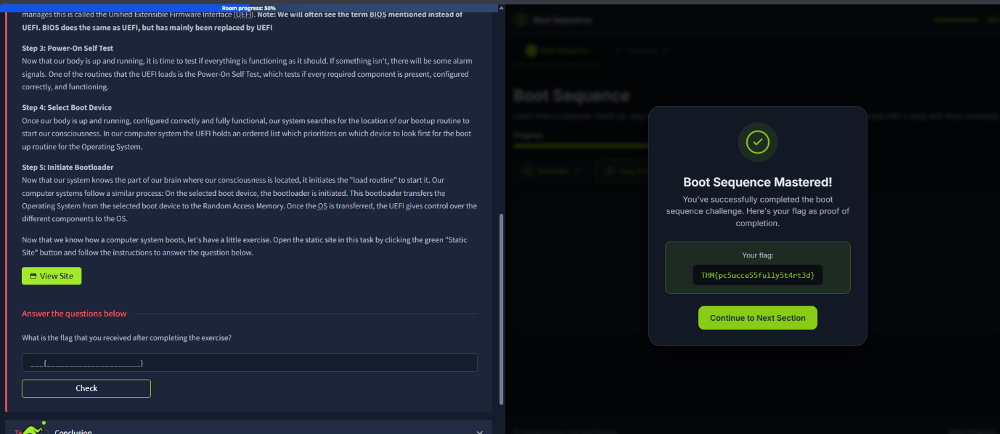
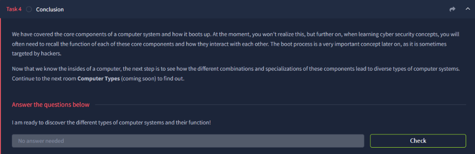

# Inside a Computer System

**Room Link:** [TryHackMe – Inside a Computer System](https://tryhackme.com/)
**Module:** Module 2 – Computer Fundamentals
**Difficulty:** Easy
**Status:** 🚧 In progress (Task 4 conclusion still to be marked)

## Objective
- Recognise and understand the function of the main components of a computer.
- Understand the boot sequence, i.e. what happens between pressing the power button and the operating system taking control.

## Key Concepts
- Motherboard, CPU, RAM, storage (SSD/HDD), network adapter, PSU, graphics card, input/output devices.
- UEFI / BIOS firmware.
- POST (Power-On Self Test).
- Boot device and bootloader.

---

## Task 1 – Introduction

**Summary:** Before securing a system, you need to understand what you are securing. The room uses a castle analogy: defending something you have never seen is impossible, so first learn the layout. This room covers what a computer is, its building blocks and how they connect.

| # | Question | Answer |
|---|----------|--------|
| 1 | Let's get started! | No answer needed |

**Notes:** The goal is a general idea of how components work together, without too much technical depth.

**Screenshot:**

---

## Task 2 – Inside a Computer System

**Summary:** The task compares PC components to the human body and uses an interactive static site with three parts: **Components**, **Inspection** and **Exercise**.

**Components and their role:**

| Component | Role |
|-----------|------|
| Motherboard | The "skeleton and nervous system". Holds all components in place and connects them (CPU socket, RAM slots, expansion slots, ports). |
| CPU | The "brain". Constantly executes instructions. |
| RAM | Short-term working memory for running programs. |
| Storage (SSD/HDD) | Long-term memory; keeps data when the power is off. |
| Network adapter | Connects the computer to a network. |
| Power supply (PSU) | Supplies power to the components. |
| Graphics card (GPU) | The "visual cortex". Handles graphics output. |
| Input/Output | How we interact with the computer (keyboard, mouse, monitor). |

**Exercise:** Drag each component to its correct connector on the motherboard (CPU socket, RAM slots, PCIe/graphics slot, storage connector, network adapter slot, PSU power connector, rear I/O panel). After placing all of them and clicking **Verify**, the site gives a flag.

| # | Question | Answer |
|---|----------|--------|
| 1 | Give in the flag you received after completing the exercise on the static site | `THM{4llpccomp0n3nts1d3nt1f13d}` |

**Notes:** Every other component plugs into or connects through the motherboard. Knowing what each part does is useful later, because attacks often target specific components (for example firmware or storage).

**Screenshots:**

Motherboard explanation:

Inspecting components (CPU quiz):

All components inspected:

Component placement exercise:

Exercise completed and flag submitted:

---

## Task 3 – What Happens When You Press the Start Button?

**Summary:** The boot sequence, explained with a human analogy (waking up):

1. **Press power button** – signal goes to the PSU to let power through; the system starts powering up.
2. **Firmware starts (UEFI/BIOS)** – the first software that runs; it initialises and coordinates the hardware. BIOS does the same job as UEFI but has mostly been replaced by it.
3. **Power-On Self Test (POST)** – checks that the required hardware is present, configured correctly and working. Errors trigger beeps or alerts.
4. **Select boot device** – UEFI follows a priority list to decide which device to boot from, usually the SSD or HDD with the OS installed.
5. **Initiate bootloader** – the bootloader loads the operating system into RAM. Then UEFI hands control to the OS and the boot sequence is complete.

After the animation, a drag-and-drop challenge tests the order of the steps.

| # | Question | Answer |
|---|----------|--------|
| 1 | What is the flag that you received after completing the exercise? | `THM{pc5ucce55fully5t4rt3d}` |

**Notes:** The boot process matters for security because it is sometimes targeted by attackers (mentioned in the room conclusion).

**Screenshots:**

Boot sequence animation:

Challenge completed:

---

## Task 4 – Conclusion

**Summary:** The room covered the core components of a computer and how it boots. These concepts will be recalled later in cyber security, especially the boot process, which is sometimes targeted by hackers. The next room is **Computer Types**.

| # | Question | Answer |
|---|----------|--------|
| 1 | I am ready to discover the different types of computer systems and their function! | No answer needed |

**Notes:** Click **Check** on the room to mark this task complete.

**Screenshot:**

---

## Takeaways
- The motherboard connects everything; the CPU executes instructions, RAM holds running data and storage keeps data permanently.
- Boot order: power button → UEFI/BIOS → POST → select boot device → bootloader loads the OS into RAM → OS takes control.
- Understanding normal system layout is the first step before learning how to secure it.
